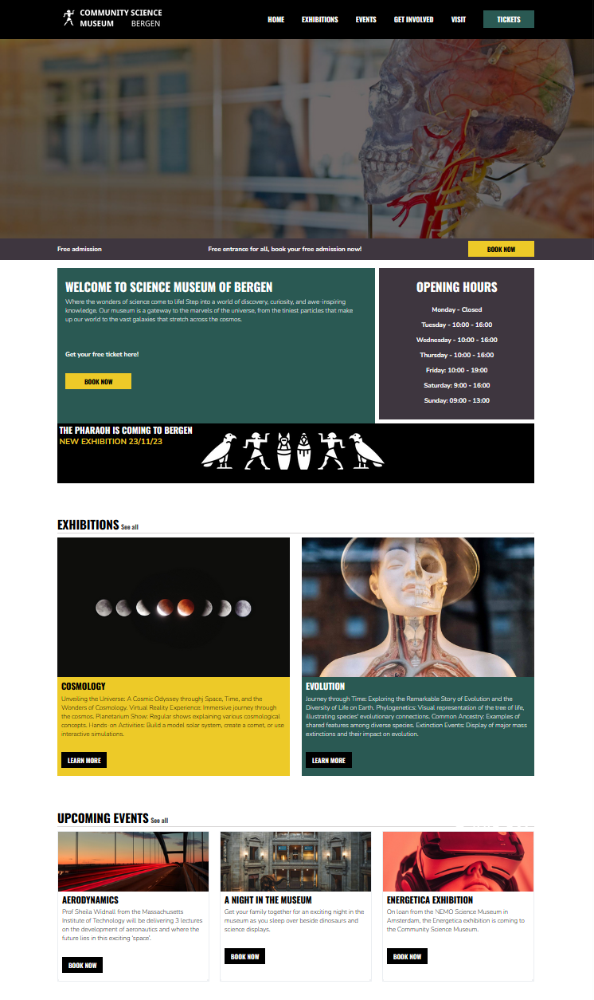

# Community Science Museum Bergen

  

  A website for a fictional science museum in Bergen. This was my Semester Project 1 at Noroff
  (frontend development), built in autumn 2023 with HTML and CSS only.

  **Live site:** https://animated-bombolone-6005db.netlify.app/

  ## What it includes

  - Six pages: home, exhibitions (with a cosmology exhibition page), visit, get involved and tickets
  - A ticket flow ending in a confirmation page
  - Forms for visiting and getting involved
  - Responsive layout from small phones (320px) to large screens
  - Semantic HTML, page titles and meta descriptions, written with WCAG and SEO in mind

  ## The assignment

  Design and build a 4–6 page responsive website for a museum, deploy it on Netlify,
  and document the process and design decisions in a report. Four weeks full-time.

  ## Built with

  - HTML
  - CSS
  - Netlify (hosting)

  ## What I would do differently today

  This was one of my first projects. Today I would:
  - take a more critical look at the UI. Back then I was just excited that I had managed to build a website at all
  - use fewer, content-based breakpoints instead of six fixed ones, I remember having difficulties with the responsiveness.
  - move repeated CSS into variables and reusable components
  - give the forms real validation and perhaps a backend

  Looking back at this project, I think all and all it was a pretty solid website for someone who just started building websites. I think I feel a bit proud of my work on this one
  You can see how my work and workflow changed in my later work, for example in [bartholomeusberg.com](https://bartholomeusberg.com).

  ## Contact
  - [LinkedIn](https://www.linkedin.com/in/bart-van-den-berg-b90219155/)
